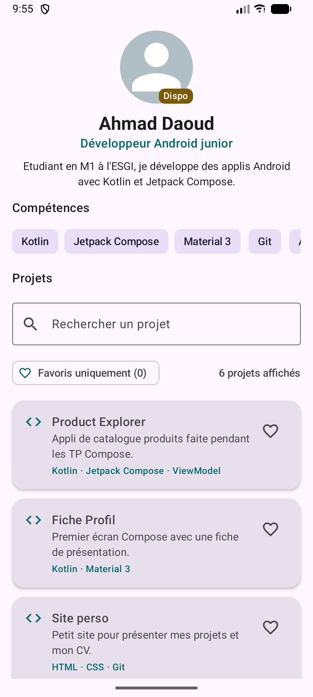
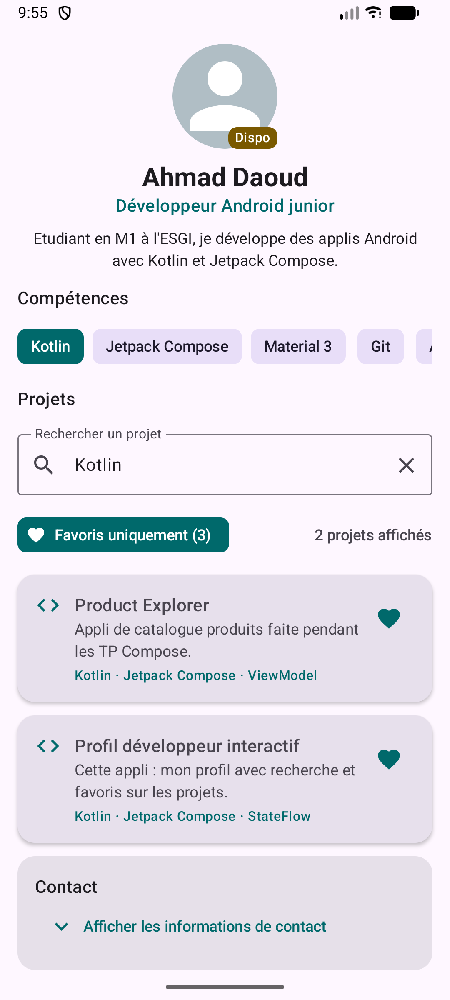
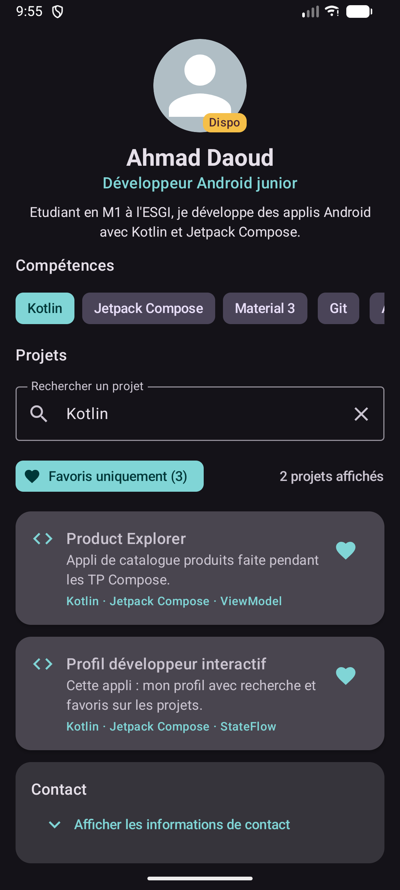
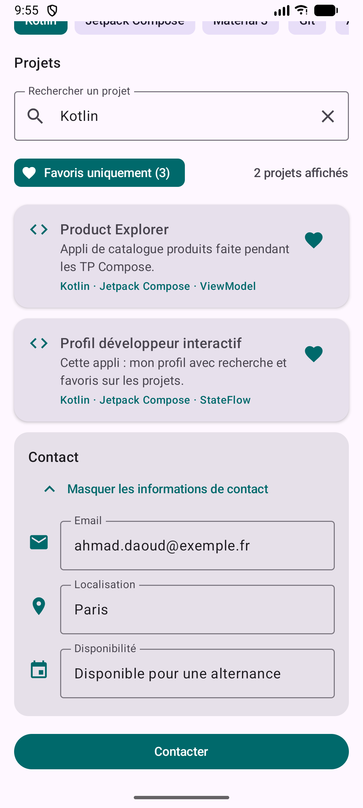

# Profil développeur interactif (Jetpack Compose)

Troisième version de mon appli « Profil développeur » pour le cours Jetpack Compose à l'ESGI (Bloc 3 : gestion de l'état).
La version précédente est dans un autre dépôt : [ProfilDeveloppeurAmeliorationCC](https://github.com/AdaoudDev/ProfilDeveloppeurAmeliorationCC).

## Description

L'appli affiche toujours mon profil sur un seul écran (avatar, nom, rôle, description, compétences, projets, contact), mais elle est maintenant interactive :

- **recherche de projets** : un champ de recherche filtre les projets par titre, technologie ou description, sans tenir compte des majuscules ; une croix permet d'effacer la recherche ;
- **favoris** : un cœur sur chaque projet permet de l'ajouter ou de le retirer des favoris (cœur plein = favori) ;
- **filtre « Favoris uniquement »** : un bouton affiche soit tous les projets, soit seulement les favoris, avec le nombre de favoris entre parenthèses ;
- **nombre de projets affichés** : « 6 projets affichés », « 1 projet affiché »… le texte suit la recherche et le filtre ;
- **compétences cliquables** : un clic sur une compétence (par exemple « Git ») la met dans la recherche, un deuxième clic efface la recherche ;
- **infos de contact** : la carte contact a un bouton « Afficher / Masquer les informations de contact ».

Les données restent locales, écrites en dur dans le code Kotlin. Il n'y a ni API, ni base de données, ni navigation.

## Captures d'écran

| Au lancement | Recherche + favoris | Recherche + favoris (sombre) | Contact affiché |
|---|---|---|---|
|  |  |  |  |

## États gérés par l'application

L'état principal de l'écran est regroupé dans `ProfileUiState` :

| Propriété | Rôle |
|---|---|
| `searchQuery` | le texte tapé dans la recherche |
| `showOnlyFavorites` | le filtre « Favoris uniquement » est actif ou non |
| `favoriteProjectIds` | les `id` des projets en favoris (un `Set<Int>`) |
| `projects` | la liste des projets réellement affichés, après la recherche et le filtre |

Le nombre de projets affichés n'est pas un état à part : c'est `projects.size`. Pareil pour le nombre de favoris, `favoriteProjectIds.size`.

En plus, un état local reste dans un composable : `showContactInfo` dans `ContactCard` (voir plus bas).

## État local

> Quel état avez-vous conservé directement dans un composable et pourquoi ?

J'ai gardé `showContactInfo` dans le composable `ContactCard`, avec `rememberSaveable { mutableStateOf(false) }`. Il dit si les informations de contact (email, localisation, disponibilité) sont affichées ou masquées.

Je l'ai laissé local parce que c'est un simple état d'affichage : il ne concerne que la carte contact, aucun autre composable n'en a besoin et il ne change pas les données de l'écran. Le mettre dans le ViewModel n'apporterait rien. J'ai utilisé `rememberSaveable` plutôt que `remember` pour que la carte reste ouverte quand on tourne l'écran.

## State Hoisting

> Pourquoi votre composable d'écran principal peut-il être considéré comme stateless ?

`ProfileScreen` ne stocke aucun état principal lui-même : il n'a ni `remember`, ni `mutableStateOf`, ni ViewModel. Tout ce qu'il affiche arrive en paramètres (`projects`, `searchQuery`, `showOnlyFavorites`, `favoriteProjectIds`…), et chaque action de l'utilisateur remonte par un callback (`onSearchQueryChange`, `onToggleFavoriteFilter`, `onFavoriteClick`, `onSkillClick`).

L'écran ne décide donc pas comment l'état est stocké : il affiche ce qu'on lui donne et prévient le parent quand l'utilisateur fait quelque chose. C'est pour ça qu'on peut l'appeler directement dans les previews avec des valeurs fixes.

## ViewModel

> Quel est le rôle de votre ViewModel dans cette application ?

`ProfileViewModel` garde l'état principal de l'écran et contient la logique des actions :

- `onSearchQueryChange(query)` change le texte de recherche ;
- `onFavoriteClick(projectId)` ajoute ou retire l'`id` du projet dans les favoris ;
- `onToggleFavoriteFilter()` active ou désactive le filtre favoris ;
- `onSkillClick(skill)` met la compétence dans la recherche, ou efface la recherche si elle y est déjà.

Après chaque action, il recalcule la liste `projects` à afficher avec la fonction `filterProjects(...)` et publie le nouvel état. Comme il survit à la rotation de l'écran, la recherche et les favoris ne sont pas perdus quand on tourne le téléphone. Il ne dépend d'aucun composant Compose de l'interface.

## StateFlow

> Comment l'interface est-elle informée lorsqu'un état change ?

Dans le ViewModel, l'état est dans un `MutableStateFlow<ProfileUiState>` privé (`_uiState`) : seul le ViewModel peut le modifier. Il expose une version publique en lecture seule, `uiState: StateFlow<ProfileUiState>`, avec `asStateFlow()`.

Quand l'utilisateur fait une action, le ViewModel crée un nouvel état avec `copy(...)` et le met dans le `MutableStateFlow` avec `update { }`. Le `StateFlow` publie alors ce nouvel état.

Côté Compose, `ProfileContainer` observe ce flux avec `viewModel.uiState.collectAsState()`. À chaque nouvel état publié, la valeur change, Compose recompose `ProfileScreen` avec les nouvelles valeurs, et l'interface se met à jour toute seule.

En résumé : l'utilisateur agit → le ViewModel met à jour l'état → le `StateFlow` publie → Compose observe et redessine l'écran.

## Organisation du code

Tout le code est dans `MainActivity.kt`, le thème est dans `ui/theme/`.

| Élément | Rôle |
|---|---|
| `Project` | un projet : `id`, `title`, `description`, `technologies` (liste) |
| `sampleProjects()` / `sampleSkills()` | les données locales écrites en dur |
| `ProfileUiState` | la classe qui regroupe l'état principal de l'écran |
| `filterProjects(...)` | fonction qui garde les projets correspondant à la recherche et au filtre favoris (utilisée par le ViewModel et par une preview) |
| `ProfileViewModel` | garde l'état dans un `StateFlow` et gère les actions |
| `ProfileContainer` | fait le lien entre le ViewModel et Compose : récupère le ViewModel, collecte le `StateFlow`, passe les valeurs et les callbacks à l'écran |
| `ProfileScreen` | l'écran principal, stateless |
| `ProjectSearchBar` | le champ de recherche avec la croix pour effacer |
| `ProjectFilterRow` | le bouton « Favoris uniquement (N) » et le nombre de projets affichés |
| `EmptyProjectsMessage` | le message quand aucun projet ne correspond |
| `ProjectCard` | la carte d'un projet avec le cœur favori |
| `SkillChip` | une compétence cliquable |
| `ContactCard` | la carte contact, avec son état local afficher / masquer |
| `ProfileHeader`, `AvatarWithBadge`, `ContactInfo`, `ContactButton` | les autres morceaux de l'écran, repris de la version précédente |
| `MainActivity` | applique le thème et affiche `ProfileContainer` |

## Previews

Les previews appellent directement `ProfileScreen`, sans ViewModel, avec des valeurs fixes :

- **Preview 1** (« Junior Android - clair » et « Junior Android - sombre ») : recherche vide, tous les projets affichés, aucun favori ;
- **Preview 2** (« Recherche + favoris ») : recherche « kotlin », filtre favoris activé, 3 projets en favoris. La liste est calculée avec `filterProjects`, donc seuls les 2 favoris qui contiennent « kotlin » sont affichés ;
- **Preview 3** (« Full-stack pas dispo ») : un autre profil, gardé de la version précédente.

## Lancer le projet

Ouvrir le dossier dans Android Studio et lancer la configuration `app` sur un émulateur ou un téléphone.
